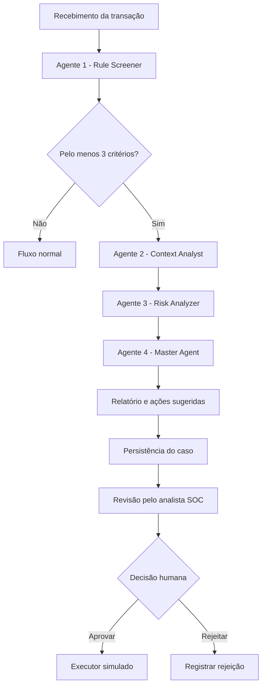

# AntFraud_Sys — Sistema Inteligente de Detecção e Análise de Fraudes

Protótipo acadêmico de prevenção a fraudes financeiras que combina regras determinísticas, Inteligência Artificial generativa e arquitetura multiagente para analisar transações, investigar comportamentos suspeitos, classificar riscos e apoiar a tomada de decisão de analistas de cibersegurança (SOC).

O projeto utiliza **Google Gemini** como provedor de IA, **FastAPI** no backend e uma interface web própria para acompanhamento dos casos e alertas.

> **Importante:** este repositório contém um protótipo acadêmico. As transações são simuladas, os casos são armazenados localmente em JSON e as ações aprovadas utilizam um executor simulado. O sistema não está conectado a um core bancário real.

---

## Sumário

- [Visão geral](#visão-geral)
- [Arquitetura multiagente](#arquitetura-multiagente)
- [Critérios de detecção](#critérios-de-detecção)
- [Classificação de risco](#classificação-de-risco)
- [Funcionalidades](#funcionalidades)
- [Tecnologias utilizadas](#tecnologias-utilizadas)
- [Estrutura do projeto](#estrutura-do-projeto)
- [Configuração e instalação](#configuração-e-instalação)
- [Executando a aplicação](#executando-a-aplicação)
- [Autenticação da API](#autenticação-da-api)
- [Endpoints](#endpoints)
- [Exemplos de utilização](#exemplos-de-utilização)
- [WebSocket de alertas](#websocket-de-alertas)
- [Testes](#testes)
- [Limitações e segurança](#limitações-e-segurança)
- [Contexto acadêmico](#contexto-acadêmico)

---

## Visão geral

O AntFraud_Sys simula um fluxo de monitoramento de transações financeiras. Cada transação passa inicialmente por uma triagem determinística. Quando a quantidade de critérios identificados atinge o limite configurado, o caso é encaminhado aos agentes responsáveis pela investigação, avaliação de risco e elaboração do relatório executivo.

O processamento pode acontecer de duas formas:

- **Monitoramento contínuo:** o monitor em segundo plano gera transações fictícias periodicamente e executa o pipeline sem depender de clientes conectados ao WebSocket.
- **Análise sob demanda:** uma transação pode ser enviada pela API ou gerada pelo endpoint de simulação.

Os casos analisados são persistidos individualmente em arquivos JSON, permitindo consultar posteriormente os resultados dos agentes e o histórico de decisões do analista.

---

## Arquitetura multiagente

A solução possui quatro agentes especializados, coordenados pelo orquestrador (`app/orchestrator.py`).

| Agente | Responsabilidade | Participação da IA |
|---|---|---|
| **Agente 1 — Rule Screener** | Valida a transação, elimina duplicidades e verifica os seis critérios de detecção. A decisão de escalada é determinística. | Gemini é utilizado somente para produzir uma justificativa contextual. |
| **Agente 2 — Context Analyst** | Investiga o perfil do remetente e do destinatário, consulta o histórico disponível e procura correlações entre eventos. | Gemini auxilia na síntese da investigação e na interpretação contextual. |
| **Agente 3 — Risk Analyzer** | Calcula o score de risco, classifica gravidade, prioridade e confiança, e organiza evidências e recomendações. | Gemini contribui com análise contextual e ajuste limitado do score, conforme as regras do agente. |
| **Agente 4 — Master Agent** | Consolida os resultados, produz o relatório executivo, gera o alerta para o SOC e define o status final do caso. | Gemini auxilia na elaboração do relatório e da narrativa em português. |

### Fluxo de processamento



**Regra de escalada:** por padrão, três ou mais critérios confirmados pelo Agente 1 encaminham a transação para os Agentes 2, 3 e 4. Transações abaixo desse limite seguem o fluxo normal.

As falhas individuais dos agentes são registradas no resultado do pipeline. O orquestrador foi desenvolvido para isolar essas falhas e permitir a continuidade do processamento quando possível.

### Modelos Gemini

Os modelos são configuráveis individualmente por agente. A configuração padrão do projeto utiliza `gemini-flash-lite-latest` para os quatro agentes.

| Variável | Agente | Temperatura documentada no pipeline |
|---|---|---:|
| `GEMINI_MODEL_AGENT1` | Rule Screener | 0.1 |
| `GEMINI_MODEL_AGENT2` | Context Analyst | 0.3 |
| `GEMINI_MODEL_AGENT3` | Risk Analyzer | 0.2 |
| `GEMINI_MODEL_AGENT4` | Master Agent | 0.3 |

O cliente Gemini está implementado em `app/core/gemini_client.py`, utilizando requisições HTTP à API Google Gemini e suporte a respostas estruturadas em JSON. Também há configuração de tentativas adicionais em caso de erros transitórios.

---

## Critérios de detecção

O Agente 1 avalia seis indicadores por meio de regras implementadas em Python:

| Critério | Descrição | Configuração padrão |
|---|---|---|
| **Valor elevado** | Identifica transações acima do limite definido. | Acima de R$ 5.000,00 |
| **Horário incomum** | Identifica operações realizadas em horários atípicos. | Das 22h às 6h |
| **Frequência elevada** | Detecta várias transações em uma janela curta. | Mais de 3 transações em 10 minutos |
| **Repetição de valores** | Procura padrões de valores repetidos em curto intervalo. | Regra implementada no agente |
| **Mudança geográfica** | Identifica localização incompatível com o histórico ou regiões sinalizadas pela regra. | Regra implementada no agente |
| **Dispositivo desconhecido** | Identifica dispositivos não reconhecidos ou não mapeados. | Regra implementada no agente |

Os parâmetros configuráveis podem ser ajustados no arquivo `.env`.

---

## Classificação de risco

O Agente 3 calcula o score de risco em uma escala de 1 a 100. A classificação utiliza cinco faixas:

| Score | Nível | Interpretação |
|---:|---|---|
| 1–20 | **Mínimo** | Evento informativo, sem necessidade de ação operacional imediata. |
| 21–40 | **Baixo** | Monitoramento preventivo recomendado. |
| 41–60 | **Médio** | Investigação e acompanhamento intensivo recomendados. |
| 61–80 | **Alto** | Revisão humana prioritária. |
| 81–100 | **Crítico** | Escalonamento urgente para análise do SOC. |

A avaliação também considera dimensões distintas de **gravidade, prioridade e confiança**, além da classificação das evidências e das lacunas de informação.

---

## Funcionalidades

### Interface web

A interface está implementada em `frontend/index.html` e apresenta uma tela de operação para analistas de cibersegurança.

As áreas disponíveis incluem:

- **Resultados:** consulta dos casos processados e seus respectivos detalhes.
- **Analisar Transação:** envio de transações para análise individual.
- **Painel de Risco:** acompanhamento da classificação e dos níveis de risco.
- **Auditoria:** consulta de informações e decisões registradas.
- **Simulação:** geração de transações fictícias para demonstração.
- **Conexão com a API:** configuração da chave `X-API-Key` diretamente na interface.

### Monitoramento em segundo plano

O monitor (`app/monitor.py`) executa continuamente, conforme as configurações:

- Gera transações fictícias por meio de `app/simulator.py`.
- Encaminha cada transação ao orquestrador.
- Atualiza contadores de processamento, escalonamento, revisão humana e falhas.
- Emite eventos para os clientes conectados via WebSocket.

O monitor pode ser iniciado automaticamente com a API ou controlado pelos endpoints específicos.

### Alertas em tempo real

O endpoint WebSocket `/ws/alerts` transmite atualizações de processamento, alertas de fraude, estatísticas do monitor e mensagens de heartbeat.

### Aprovação humana

O Agente 4 gera ações sugeridas com identificadores próprios. O analista pode aprovar ou rejeitar cada ação.

- **Aprovação:** encaminha a ação ao executor simulado e registra o resultado.
- **Rejeição:** registra a decisão do analista sem executar a ação.

O executor atual (`app/action_executor.py`) simula o resultado das operações. Nenhuma operação bancária real é executada pelo protótipo.

### Persistência de casos

Os dossiês são armazenados em arquivos JSON individuais no diretório:

```text
app/data/cases/
```

Essa persistência é local e voltada ao protótipo. Não representa uma integração com banco de dados de produção.

---

## Tecnologias utilizadas

| Tecnologia | Aplicação |
|---|---|
| **Python** | Linguagem principal do backend e dos agentes. |
| **FastAPI** | Construção dos endpoints REST. |
| **Uvicorn** | Servidor ASGI da aplicação. |
| **Google Gemini API** | Geração de justificativas, investigação contextual, avaliação e relatórios. |
| **Pydantic v2** | Validação e estruturação dos dados. |
| **Pydantic Settings** | Leitura e gerenciamento das configurações. |
| **Requests** | Comunicação HTTP com a API Gemini. |
| **WebSocket** | Envio de alertas e atualizações em tempo real. |
| **HTML, CSS e JavaScript** | Construção da interface web. |
| **JSON** | Dataset de transações e persistência local dos casos. |
| **Pytest** | Testes automatizados do projeto. |

---

## Estrutura do projeto

```text
antFraud_Sys/
│
├── main.py
├── requirements.txt
├── .env.example
├── .gitignore
├── start.ps1
├── README.md
│
├── app/
│   ├── core/
│   │   ├── config.py
│   │   ├── gemini_client.py
│   │   └── security.py
│   │
│   ├── agents/
│   │   ├── agent_rule_screener.py
│   │   ├── agent_context_analyst.py
│   │   ├── agent_risk_analyzer.py
│   │   └── agent_master.py
│   │
│   ├── models/
│   │   └── schemas.py
│   │
│   ├── routes/
│   │   ├── fraud.py
│   │   └── websocket.py
│   │
│   ├── data/
│   │   ├── transactions.json
│   │   └── cases/
│   │
│   ├── orchestrator.py
│   ├── monitor.py
│   ├── simulator.py
│   ├── case_storage.py
│   └── action_executor.py
│
├── frontend/
│   └── index.html
│
└── tests/
    ├── test_system.py
    ├── test_approval_flow.py
    └── test_unit.py
```

**Responsabilidade dos principais módulos:**

- `main.py`: inicialização do FastAPI, configuração de CORS e ciclo de vida do monitor.
- `app/core/config.py`: configurações centralizadas e leitura do `.env`.
- `app/core/gemini_client.py`: cliente de integração com a API Gemini.
- `app/core/security.py`: autenticação dos endpoints protegidos.
- `app/agents/`: implementação dos quatro agentes especializados.
- `app/orchestrator.py`: coordenação do pipeline e persistência dos resultados.
- `app/monitor.py`: execução contínua do monitoramento.
- `app/simulator.py`: geração de transações fictícias.
- `app/case_storage.py`: armazenamento e consulta dos casos em JSON.
- `app/action_executor.py`: execução simulada das ações aprovadas.
- `app/routes/`: endpoints REST e WebSocket.
- `frontend/index.html`: interface web.
- `tests/`: testes automatizados.

---

## Configuração e instalação

### Pré-requisitos

- Python 3.10 ou superior, compatível com as dependências instaladas.
- Uma chave de API do Google Gemini.
- Git (opcional, para clonar o repositório).

A chave Gemini pode ser obtida pelo [Google AI Studio](https://aistudio.google.com/).

### 1. Clonar o repositório

```bash
git clone https://github.com/AndreSantos34/antFraud_Sys.git

cd antFraud_Sys
```

### 2. Criar o ambiente virtual

```bash
python -m venv .venv
```

**Windows — PowerShell:**

```powershell
.\.venv\Scripts\Activate.ps1
```

**Linux/macOS:**

```bash
source .venv/bin/activate
```

### 3. Instalar as dependências

```bash
python -m pip install --upgrade pip

pip install -r requirements.txt
```

### 4. Configurar as variáveis de ambiente

Crie o arquivo `.env` a partir do modelo:

**Windows — PowerShell:**

```powershell
Copy-Item .env.example .env
```

**Linux/macOS:**

```bash
cp .env.example .env
```

Edite o `.env` e informe sua chave Gemini:

```env
GEMINI_API_KEY=sua_chave_google_gemini

# Modelos dos agentes
GEMINI_MODEL_AGENT1=gemini-flash-lite-latest
GEMINI_MODEL_AGENT2=gemini-flash-lite-latest
GEMINI_MODEL_AGENT3=gemini-flash-lite-latest
GEMINI_MODEL_AGENT4=gemini-flash-lite-latest

# API
APP_PORT=8000
APP_HOST=0.0.0.0
DEBUG=true

# Segurança
API_SECRET_KEY=gere_uma_chave_forte_e_unica

# Monitoramento
MONITOR_INTERVAL_SECONDS=2.0
MONITOR_AUTOSTART=true

# Critérios de detecção
HIGH_VALUE_THRESHOLD=5000.00
UNUSUAL_HOUR_START=22
UNUSUAL_HOUR_END=6
HIGH_FREQ_MAX_TX=3
HIGH_FREQ_WINDOW_MIN=10

# Integração bancária (não utilizada pelo executor atual)
BANKING_API_URL=
BANKING_API_TOKEN=
BANKING_API_TIMEOUT_S=10
```

As variáveis de modelos, monitoramento e limites possuem valores padrão no código, mas podem ser personalizadas pelo `.env`.

> **Segurança:** nunca publique o arquivo `.env`, chaves de API ou tokens no GitHub. O repositório disponibiliza `.env.example` para documentar as configurações necessárias.

---

## Executando a aplicação

### Opção 1 — Inicialização manual

Com o ambiente virtual ativado, inicie o backend:

```bash
uvicorn main:app --reload --port 8000
```

Em outro terminal, na raiz do projeto, inicie o frontend:

```bash
python -m http.server 3000 --directory frontend
```

Acesse:

| Serviço | Endereço |
|---|---|
| Interface web | http://localhost:3000 |
| Backend FastAPI | http://localhost:8000 |
| Swagger UI | http://localhost:8000/docs |
| ReDoc | http://localhost:8000/redoc |
| Health Check | http://localhost:8000/api/v1/health |

### Opção 2 — Script PowerShell (Windows)

O projeto possui o script `start.ps1`, que inicia o backend e o frontend em janelas separadas e abre a interface no navegador.

Na raiz do projeto, execute:

```powershell
.\start.ps1
```

Se o PowerShell bloquear a execução do script, verifique a política de execução configurada no seu ambiente. Não é necessário alterar permanentemente a política do sistema para executar o projeto.

---

## Autenticação da API

Os endpoints protegidos sob `/api/v1/` exigem a chave configurada em `API_SECRET_KEY`.

Envie a chave no cabeçalho HTTP:

```http
X-API-Key: sua_chave_configurada
```

Exemplo:

```bash
curl -H "X-API-Key: sua_chave_configurada" \
  http://localhost:8000/api/v1/cases
```

O endpoint `GET /api/v1/health` é público e pode ser utilizado para verificar o estado da aplicação e a configuração do Gemini.

O WebSocket possui autenticação própria por meio do parâmetro `api_key` na URL de conexão.

---

## Endpoints

### Saúde e dados

| Método | Rota | Descrição |
|---|---|---|
| `GET` | `/` | Retorna informações gerais, versão e referências da API. |
| `GET` | `/api/v1/health` | Verifica a API, a configuração Gemini, o pipeline e o monitor. |
| `GET` | `/api/v1/transactions` | Lista as transações do dataset sem executar uma nova análise. |

### Análise e ingestão

| Método | Rota | Descrição |
|---|---|---|
| `POST` | `/api/v1/transactions/ingest` | Recebe uma transação e agenda o processamento em segundo plano. Retorna HTTP 202. |
| `POST` | `/api/v1/analyze` | Executa a análise síncrona de uma transação enviada no corpo da requisição. |
| `GET` | `/api/v1/analyze/{transaction_id}` | Analisa uma transação do dataset pelo identificador. |
| `POST` | `/api/v1/analyze/batch` | Processa em lote as transações do dataset. |

### Casos e auditoria

| Método | Rota | Descrição |
|---|---|---|
| `GET` | `/api/v1/cases` | Lista os casos suspeitos persistidos. |
| `GET` | `/api/v1/cases/{case_id}` | Retorna o dossiê completo de um caso. |
| `GET` | `/api/v1/cases/{case_id}/actions` | Consulta as ações sugeridas e o histórico de decisões. |
| `POST` | `/api/v1/cases/{case_id}/actions/{action_id}/approve` | Aprova uma ação pendente e aciona o executor simulado. |
| `POST` | `/api/v1/cases/{case_id}/actions/{action_id}/reject` | Rejeita uma ação pendente e registra a decisão. |

### Monitoramento e simulação

| Método | Rota | Descrição |
|---|---|---|
| `POST` | `/api/v1/monitor/start` | Inicia o monitor em segundo plano. |
| `POST` | `/api/v1/monitor/stop` | Interrompe o monitor. |
| `GET` | `/api/v1/monitor/stats` | Retorna as estatísticas do monitor. |
| `POST` | `/api/v1/simulate/transaction` | Gera e analisa uma transação fictícia. |
| `POST` | `/api/v1/demo/reset` | Apaga os casos persistidos e reprocessa o dataset. |

**Atenção:** `/api/v1/demo/reset` é uma operação destrutiva: os casos existentes são apagados antes do reprocessamento.

Com exceção das rotas públicas de raiz e health check, os endpoints `/api/v1/` exigem `X-API-Key`.

---

## Exemplos de utilização

### 1. Analisar uma transação personalizada

**Endpoint:** `POST /api/v1/analyze`

```bash
curl -X POST "http://localhost:8000/api/v1/analyze" \
  -H "Content-Type: application/json" \
  -H "X-API-Key: sua_chave_configurada" \
  -d '{
    "transaction_id": "TXN-999",
    "customer_id": "CLI-9999",
    "receiver_id": "CLI-8888",
    "amount": 9800.00,
    "datetime": "2024-06-10T02:37:00",
    "location": "Miami, EUA",
    "channel": "internet_banking",
    "device": "dispositivo_desconhecido"
  }'
```

A análise síncrona retorna os resultados do pipeline, incluindo os dados de detecção, investigação, avaliação de risco e relatório mestre, conforme o fluxo acionado.

### 2. Ingerir uma transação em segundo plano

**Endpoint:** `POST /api/v1/transactions/ingest`

```bash
curl -X POST "http://localhost:8000/api/v1/transactions/ingest" \
  -H "Content-Type: application/json" \
  -H "X-API-Key: sua_chave_configurada" \
  -d '{
    "transaction_id": "TXN-1000",
    "customer_id": "CLI-1001",
    "receiver_id": "CLI-2001",
    "amount": 7200.00,
    "datetime": "2026-11-05T02:30:00",
    "location": "São Paulo, SP",
    "channel": "app_mobile",
    "device": "smartphone_desconhecido"
  }'
```

O endpoint responde com HTTP `202 Accepted`, indicando que a transação foi aceita para processamento. O resultado pode ser acompanhado pelo WebSocket ou consultado posteriormente em `/api/v1/cases`.

### 3. Gerar uma transação suspeita para demonstração

**Endpoint:** `POST /api/v1/simulate/transaction?force_suspicious=true`

```bash
curl -X POST \
  "http://localhost:8000/api/v1/simulate/transaction?force_suspicious=true" \
  -H "X-API-Key: sua_chave_configurada"
```

O parâmetro `force_suspicious=true` solicita ao simulador uma transação com pelo menos três critérios para exercitar o fluxo completo de investigação.

### 4. Consultar casos

```bash
curl "http://localhost:8000/api/v1/cases" \
  -H "X-API-Key: sua_chave_configurada"
```

Para consultar um caso específico:

```bash
curl "http://localhost:8000/api/v1/cases/ID_DO_CASO" \
  -H "X-API-Key: sua_chave_configurada"
```

---

## WebSocket de alertas

O sistema disponibiliza um canal WebSocket para atualizações em tempo real.

**Endereço local:**

```text
ws://localhost:8000/ws/alerts?api_key=SUA_API_SECRET_KEY
```

Eventos enviados pelo servidor:

| Evento | Descrição |
|---|---|
| `connected` | Confirma que a conexão foi estabelecida. |
| `status_update` | Informa mudanças no estado do processamento. |
| `fraud_alert` | Notifica um alerta de transação suspeita. |
| `monitor_stats` | Envia estatísticas do monitor. |
| `heartbeat` | Mantém a conexão ativa. |

Para solicitar estatísticas imediatamente, envie:

```json
{
  "action": "stats"
}
 HEAD
Dataset de TesteO arquivo app/data/transactions.json conta com 20 registros fictícios simulando cenários reais:12 Transações Normais: Operações comuns sem alertas disparados.8 Transações Suspeitas: Operações com um ou múltiplos critérios de alerta ativos.Disclaimer: Todo o conjunto de dados é puramente sintético e acadêmico, não refletindo parâmetros ou dados operacionais reais da Núclea ou de parceiros financeiros.Limitações e Isenção de ResponsabilidadeValidação Humana: A indicação de suspeita não confirma a ocorrência de fraude. Qualquer tomada de decisão administrativa ou financeira deve ser precedida de análise por especialistas humanos.Falsos Positivos e Negativos: Como protótipo conceitual, a acurácia dos modelos IBM WatsonX deve ser calibrada continuamente para ambientes de produção.Projeto Acadêmico — Núclea / IBM

```

O WebSocket é utilizado para transmitir atualizações à interface. O processamento do monitor continua funcionando mesmo quando não há clientes conectados.

---

## Testes

Os testes automatizados estão organizados no diretório `tests/`:

```text
tests/
├── test_system.py
├── test_approval_flow.py
└── test_unit.py
```

Para executar a suíte de testes:

```bash
pytest -v
```

Caso o comando não esteja disponível:

```bash
python -m pip install pytest
python -m pytest -v
```

---

## Limitações e segurança

- **Dados sintéticos:** o simulador e o dataset são destinados a demonstrações e testes, não representam transações bancárias reais.
- **Sem integração bancária ativa:** o executor atual simula os resultados das ações aprovadas. As variáveis `BANKING_API_URL` e `BANKING_API_TOKEN` estão reservadas para uma possível integração futura.
- **Aprovação humana:** nenhuma ação sugerida é executada automaticamente. O fluxo de aprovação exige uma decisão explícita do analista.
- **Persistência local:** os casos são salvos em arquivos JSON. Para produção, recomenda-se substituir esse mecanismo por uma solução de banco de dados apropriada.
- **Monitoramento simulado:** o monitor gera transações fictícias. Em um ambiente real, essa fonte deverá ser substituída por uma integração segura, como fila de mensagens ou webhook.
- **Modelos de IA:** as respostas generativas podem conter imprecisões. Resultados e recomendações devem ser revisados por profissionais.
- **Segurança de API:** a chave deve ser forte, privada e diferente do valor de desenvolvimento. CORS e demais configurações também devem ser restringidos antes de qualquer implantação pública.
- **Não é confirmação de fraude:** uma classificação de risco indica sinais que merecem análise, não comprova atividade fraudulenta.

---

## Contexto acadêmico

Projeto acadêmico desenvolvido no contexto de inovação e prevenção a fraudes, com referência à **Núclea / IBM**.

**Objetivo:** demonstrar como regras determinísticas e agentes de Inteligência Artificial podem trabalhar em conjunto para identificar padrões suspeitos, enriquecer investigações, classificar riscos e apoiar a atuação de equipes de segurança.

**Status:** protótipo acadêmico funcional.

---

*AntFraud_Sys — Inteligência Artificial aplicada à análise e prevenção de fraudes financeiras.*
 8c4dcd4 (docs: update project README)
